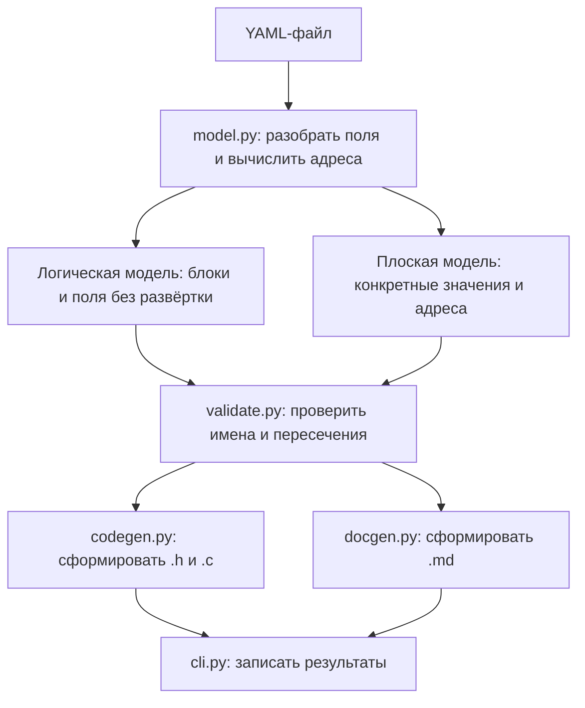

# modbus-regmodel

Генератор диспетчера Modbus holding-регистров (`modbus_reg_model.c` / `.h`)
и человекочитаемой документации (`.md`) из YAML-спецификации регистровой
карты устройства.

Поддерживаются одиночные регистры (`registers`), повторяемые группы
(`blocks`) и раскладка по полям (`planar_blocks`). Обе раскладки
разворачиваются в Python; C-код использует обычный `switch-case`.
Для `blocks` параметр `step` задаёт шаг между экземплярами в Modbus-регистрах.
Для `planar_blocks` используется `capacity`: вместимость каждой колонки
в экземплярах, по умолчанию равная `repeat`. Размер колонки равен
`capacity * size(type)`, а её начало вычисляется по сумме размеров
предыдущих колонок. Старый `step` в planar запрещён.
Полный формат и примеры описаны в [yaml-descr.md](yaml-descr.md).
Подтверждённые проблемы и предлагаемые исправления перечислены в
[KNOWN_ISSUES.md](KNOWN_ISSUES.md).

## Использование

```bash
python generate.py path/to/regmodel.yaml
python generate.py path/to/regmodel.yaml --dry-run   # только проверить, ничего не писать
```

Пути к выходным файлам задаются в YAML (необязательно) относительно
расположения самого YAML-файла и поддерживают выход на уровень выше через `..`:

```yaml
output:
  header: "../source/modbus_reg_model.h"
  source: "../source/modbus_reg_model.c"
  docs: "../docs/regmodel.md"
```

Если `output` (или отдельные его поля) не указаны - соответствующие файлы
кладутся рядом с YAML под именами по умолчанию: `modbus_reg_model.h`,
`modbus_reg_model.c`, `modbus_reg_model.md`.

## Структура

- `modbus_regmodel/types.py`    - canonical-типы, таблицы размеров, `WrapperKey`
- `modbus_regmodel/paths.py`    - разрешение путей вывода (.h/.c/.md)
- `modbus_regmodel/model.py`    - разбор YAML, логическая и плоская модели, структурные проверки
- `modbus_regmodel/validate.py` - перекрёстные проверки (уникальность имён, пересечения адресов)
- `modbus_regmodel/codegen.py`  - генерация .h/.c
- `modbus_regmodel/docgen.py`   - генерация .md (документация по регистровой карте)
- `modbus_regmodel/cli.py`      - точка входа

## Как работает генератор

Генератор читает описание, заранее вычисляет адреса и формирует готовый
C-код. Все вычисления раскладки выполняются на ПК при генерации.



### Запуск и порядок действий

`generate.py` передаёт аргументы командной строки в `cli.py`. Дальше
последовательность линейная:

1. Прочитать YAML и построить модели.
2. Проверить модель целиком.
3. Отсортировать конкретные записи по адресу.
4. Сформировать тексты `.h`, `.c` и `.md`.
5. Записать их по путям из `output`.

При обнаружении ошибок модели запись не начинается. `--dry-run` проходит
те же стадии до записи: проверяет описание, формирует тексты и показывает
выходные пути. Генератор сам не запускает C-компилятор.

### Зачем нужны две модели

`model.py` строит два представления одного описания.

**Логическая модель** сохраняет группы, как их описал пользователь:
например, блок SLAVE, 12 экземпляров и список полей внутри него. Она нужна,
чтобы документация показывала блок один раз, а проверка пересечений видела
полную область блока вместе с резервными хвостами.

**Плоская модель** содержит отдельную запись для каждого значения после
развёртки `repeat` и `count`. В ней уже известны конкретный адрес, тип,
итоговое имя, getter/setter и индексы, которые нужно передать этим функциям.

Например, для поля STATE planar-блока с началом 5000 и тремя экземплярами:

| Адрес | Тип | Getter | Аргумент instance |
| ---: | --- | --- | ---: |
| 5000 | uint16_t | get_state | 0 |
| 5001 | uint16_t | get_state | 1 |
| 5002 | uint16_t | get_state | 2 |

Одна плоская запись означает одно значение, а не обязательно один
Modbus-регистр. `uint32_t`, `int32_t` и `float` представлены одной записью,
занимающей два соседних регистра.

Разница между `blocks` и `planar_blocks` учитывается в `model.py`.
Генератор обработчиков получает готовый плоский список. Признак `is_planar`
нужен для формирования имён, описания колонок и расчёта полной области блока.

### Проверка описания

Проверки разделены по тому, какие данные им нужны:

- `model.py` проверяет отдельные поля и определения: обязательные значения,
  тип, `count`, `repeat`, `step`, `capacity`, допустимость имён и границы адресов.
- `validate.py` проверяет модель целиком: совпадение итоговых имён и
  пересечения областей между разными регистрами и блоками.

При проверке пересечений блок занимает всю свою область, включая неявные
хвосты. Поля внутри обычного блока размещены последовательно, а внутри
planar-блока — по колонкам; их взаимное размещение обеспечивает парсер.
Резервные поля остаются в моделях и участвуют в проверках.

Проверки входного формата пока неполны. Случаи молчаливого игнорирования
ошибок и другие ограничения описаны в [KNOWN_ISSUES.md](KNOWN_ISSUES.md).

### Генерация C

`codegen.py` проходит по плоскому списку и выводит:

- символьные адреса `#define` для именованных полей с getter или setter;
- небольшие обёртки для связи типизированных функций пользователя с API
  библиотеки ModbusSlave;
- `switch-case` чтения — только для полей с getter;
- `switch-case` записи — только для полей с setter;
- `ModbusRegModelInit()`, которая подключает оба обработчика к библиотеке.

Пример одного сгенерированного участка:

```c
case SLAVE_BY_FIELD_STATE_2:
{
    read_reg16_u16_inst(context, get_state, 2);
}
break;
```

Адрес и номер экземпляра уже вычислены. В C нет вычисления шага или
раскладки. Компилятор получает обычный `switch-case`.

Обёртка вызывает getter и передаёт полученное значение библиотеке либо
извлекает значение из запроса и вызывает setter. Setter вызывается только
при успешном извлечении. Это сохраняет атомарность записи 32-битного поля:
обе половины должны быть переданы одним запросом.

`bool` преобразуется в 16-битное значение 0/1, а биты `float` копируются
через `memcpy`. Одна обёртка переиспользуется всеми полями с одинаковыми
типом, направлением операции и набором индексов. Неиспользуемые обёртки
не выводятся. Эти сочетания описывает `WrapperKey` из `types.py`.

Заголовок `.h` почти статический: он объявляет `ModbusRegModelInit()`.
Адресные макросы находятся в `.c`. Прототипы пользовательских getter/setter
должны приходить из заголовков, перечисленных в `includes`; генератор их
не объявляет.

### Генерация документации и запись файлов

`docgen.py` использует обе модели: логическую — для компактных таблиц
блоков, плоскую — для полной карты конкретных адресов. Числовые примеры
planar-адресов вычисляются из текущей модели; общие формулы и пояснения
берутся из текста генератора.

`paths.py` вычисляет выходные пути относительно YAML. `cli.py` записывает
готовые тексты. Ограничения проверки путей перечислены в списке проблем.

### Что делает библиотека во время работы прошивки

Сам генератор на МК не выполняется. В прошивку попадает созданный C-код.
Библиотека ModbusSlave разбирает запрос, вызывает сгенерированный
обработчик и формирует ответ. Через `context` она передаёт буфер и число
оставшихся регистров; функции обработки значений сообщают, сколько
регистров использовано.

Необработанное чтение библиотека заполняет нулём, необработанную запись
игнорирует. Поэтому для резервов не нужны отдельные `case`. По той же
причине запись в RO игнорируется, а чтение WO возвращает ноль.

Обращение со второго слова 32-битного значения пока также попадает в
необработанный адрес. Расширение API для ошибки такого обращения отложено
и описано в [разделе 7 спецификации](yaml-descr.md#7-отложенная-задача-обращение-ко-второму-слову-32-битного-значения).

## Тесты

```bash
python -m unittest discover -s tests -v
```

- `tests/test_generator.py` - разбор YAML, валидация, кодогенерация .c/.h, пути вывода
- `tests/test_docgen.py`    - генерация markdown-документации
- `tests/test_planar.py`    - адреса колонок разных типов, вместимость, резервы,
  пересечения, имена, запрет `count`, C-диспетчер и документация planar
- `tests/test_compile.py`   - сквозной тест: сгенерированный `.c` реально
  проверяется GCC (`-fsyntax-only`) или MSVC (`/Zs`) с заглушками библиотеки
  Modbus-слейва и пользовательских getter/setter
- `tests/test_runtime.py`   - выполнение сгенерированного обработчика вместе
  с настоящим PDU-парсером ModbusSlave: резервы, хвосты, адреса вне модели,
  RO, индексы экземпляров и атомарная запись 32-битного значения в обеих раскладках

Для C-проверок GCC или MSVC (`cl`) должен быть доступен в `PATH`. Для MSVC
запускайте тесты из Developer Command Prompt/PowerShell Visual Studio.
Если ни один компилятор не найден, эти проверки пропускаются.
